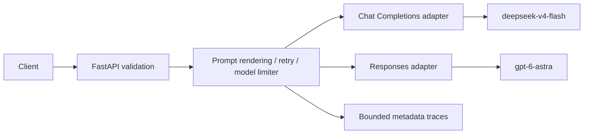

# Python LLM Gateway

A single-process implementation of the gateway requirements. FastAPI exposes a unified API; the service routes by model to two protocol adapters:



## Setup and run

Requires Python 3.11 or newer. From this directory:

```bash
python3 -m venv .venv
.venv/bin/pip install -e '.[test]'
cp .env.example .env
# Edit .env locally with your credentials; never commit it.
set -a
source .env
set +a
.venv/bin/uvicorn gateway.main:app --host 127.0.0.1 --port 8000
```

The app reads process environment variables; it does not automatically load `.env`.
Use one worker. Templates, trace history, and model limiters are in memory and reset on restart.
API documentation is at http://127.0.0.1:8000/docs.
If `GATEWAY_API_KEY` is set, supply `Authorization: Bearer <gateway-key>` on all API requests.

## Examples

Complete response:

```bash
curl http://127.0.0.1:8000/v1/llm \
  -H 'Content-Type: application/json' \
  -d '{"model":"deepseek-v4-flash","messages":[{"role":"user","content":"Explain a gateway in one sentence."}]}'
```

Streaming uses the same endpoint:

```bash
curl -N http://127.0.0.1:8000/v1/llm \
  -H 'Content-Type: application/json' \
  -d '{"model":"deepseek-v4-flash","stream":true,"messages":[{"role":"user","content":"Count to three."}]}'
```

Events are SSE `data:` JSON with `type` equal to `content.delta`, `response.completed`, or `response.failed`. Every event carries the same request ID. Terminal success includes selected model, usage, and time to first content token. Errors before the first content event retain HTTP status; after content begins they are stream events. No retry or fallback occurs after content is emitted.

Structured JSON and a versioned prompt:

```json
{
  "model": "deepseek-v4-flash",
  "messages": [{"role": "user", "content": "Should we search for missing policy information?"}],
  "prompt": {
    "name": "knowledge_decision",
    "version": "v1",
    "variables": {"product_name": "Demo"}
  },
  "response_format": {
    "type": "json_schema",
    "json_schema": {
      "name": "decision",
      "strict": true,
      "schema": {
        "type": "object",
        "properties": {"search": {"type": "boolean"}},
        "required": ["search"],
        "additionalProperties": false
      }
    }
  }
}
```

`{"type":"json_object"}` is also supported. Schemas must describe an object at the root. DeepSeek uses JSON mode plus instructions and local validation; OpenAI Responses uses `text.format` plus local validation. OpenAI strict mode supports a subset of JSON Schema: use required properties and `additionalProperties: false`. Unsupported upstream schemas fail without retry. Streaming and structured output cannot be combined.

Templates are stored in the controlled `TEMPLATES` registry in [services/prompts.py](gateway/services/prompts.py). Add a new `(name, version)` entry to publish a version; requests select a version and provide substitution variables, never template source. Callers can still supply system messages: template management is not a prompt-injection defense.

## Configuration and behavior

See [.env.example](.env.example). Defaults:

| Setting | Default |
|---|---|
| Primary model / protocol | `deepseek-v4-flash` / Chat Completions |
| Backup model / protocol | `gpt-6-astra` / Responses |
| Model rate limits | 60 upstream attempts per rolling minute, independently per model |
| Attempt timeout | 30 seconds (`timeout_seconds`, max 120) |
| Overall deadline | 120 seconds (`deadline_seconds`, max 600) |
| Retry budget | Initial attempt + 3 retries per model |
| Backoff | 0.25, 0.5, 1 second, each with up to 25% additive jitter |
| Trace retention | Most recent 1,000 requests |

The registry uses actual configured model identifiers as the public `model` values. A direct backup request does not fall back to the primary. SDK automatic retries are disabled. Connection failures, timeouts, HTTP 408/429, and upstream 5xx errors are retryable. Numeric upstream `Retry-After` values are respected, subject to the overall deadline. Other upstream errors, missing credentials, invalid JSON, and schema validation failures are terminal.

When primary retries are exhausted, backup retries may follow: at most eight upstream attempts overall, unless the deadline or a local rate limit stops the request. Each attempt consumes the selected model's quota. Local quota exhaustion returns HTTP 429 with `Retry-After` and does not trigger fallback. There is no waiting queue.

## Observability and privacy

`GET /v1/traces` and the `llm_gateway` logger expose metadata only:

- Request ID, timestamp, configured requested/selected models and template version.
- Total latency and first content-token latency for streams; non-streaming first-token latency is unknown (`null`).
- Per-attempt model, outcome, error code, latency, and usage.
- Input/output token counts, optional cached-input/reasoning-output breakdowns.
- Known usage totals across attempts and `usage_complete`, indicating whether every attempt reported input/output counts. Cached and reasoning categories are subsets, not extra tokens to add again.

Unknown token counts are `null`, not zero. Failed calls may still incur provider charges without reporting usage. Monetary estimates are intentionally omitted because prices and incomplete usage would make them misleading. Top-level usage describes the latest reported response; per-attempt usage and known totals support accounting across retries. Validation failures are traced with a safe generic error, without echoing the invalid input.

Credentials stay in environment variables; request bodies, prompt values, outputs, raw SDK exceptions, and authorization headers are excluded from application traces. SDK debug logging is suppressed. An optional gateway bearer key protects invocation and trace endpoints. Without it, bind to localhost for this demo. Process memory contains prompts during calls, and content is sent to the selected provider, including OpenAI on fallback. There is no automatic personal-data redaction, encryption-at-rest layer, tenant isolation, or durable audit storage.

## Validation

Run the complete validation runner from this directory:

```bash
.venv/bin/python scripts/validate_gateway.py
```

It first runs the mocked test suite, covering both provider protocols, structured output, SSE, prompt rendering, retries, fallback, limits, deadlines, cleanup, privacy, and authentication. It then makes one short live completion request for every configured provider. Live results print only the model alias, success/failure status, normalized error code, HTTP status, and token usage; credentials and provider response bodies are never printed. Use `--skip-live` when credentials are unavailable:

```bash
.venv/bin/python scripts/validate_gateway.py --skip-live
```

The command exits nonzero if tests fail or any configured provider lacks credentials or rejects its live request. A provider may return a valid HTTP error such as quota exhaustion; that is reported as a failed live check rather than hidden.

## Tests and verification

```bash
.venv/bin/pytest -q -W error::RuntimeWarning
```

Tests use fake providers and mocked HTTP transport, with no real credentials or billable requests. They cover both wire protocols, output validation, SSE usage, retries/backoff, fallback, local limits, deadlines, disconnect cleanup, prompt rendering, privacy, and authentication.

Live checks on 2026-10-25: both `deepseek-v4-flash` and `gpt-6-astra` completed successfully and returned usage metadata. The mocked suite remains the evidence for structured JSON, SSE, retries, fallback, rate limiting, prompt rendering, and privacy behavior.

Protocol references: [DeepSeek Chat Completions](https://api-docs.deepseek.com/api/create-chat-completion/), [OpenAI Responses](https://developers.openai.com/api/reference/resources/responses/methods/create), [GPT-6 Astra model](https://developers.openai.com/api/docs/models/gpt-6-astra).

## Source layout

- [models.py](gateway/models.py): validated public contracts.
- [providers.py](gateway/providers.py): provider protocol and adapters.
- [main.py](gateway/main.py): application entrypoint, provider wiring, authentication, and lifecycle.
- [api/routes.py](gateway/api/routes.py): HTTP and SSE endpoints.
- [core/](gateway/core/): errors, retry policy, rate limits, and runtime types.
- [services/](gateway/services/): orchestration, prompts, structured output, and observability.
- [tests](tests): service and protocol tests.
